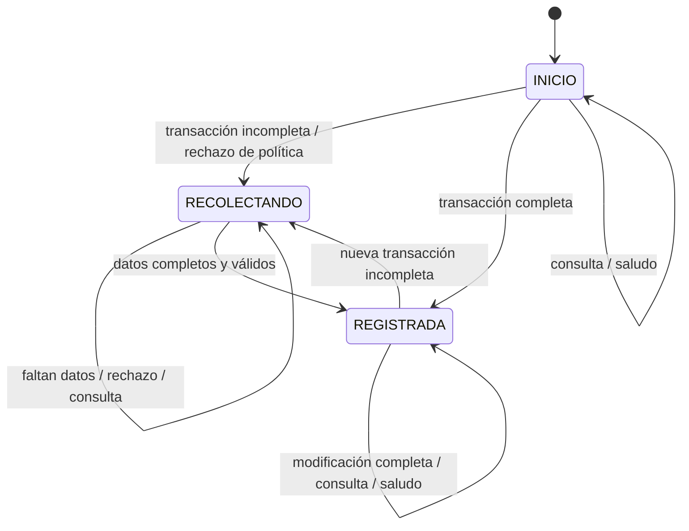

# Fase 2 — Explicación del código y comparación con versiones simplificadas

**Proyecto:** Opción 3, *Asistente de atención* para "La Picada de Lang-Chi" (TICS-200, PLN, UAI).
**Etapa 2 del enunciado:** *"Explicar cada parte del código y comparar versiones simplificadas"*.

La idea que guía esta fase es la de la primera clase: **"Los LLMs no son la única solución"**. Cada clase del curso terminó con una sección *"…en la era de los LLM"* que repetía el mismo patrón: la técnica clásica es determinista, barata y auditable; el LLM es flexible pero alucina, cuesta y no se puede inspeccionar. Esta fase pone a prueba esa idea pieza por pieza sobre nuestro chatbot.

La V1 (`../Version1.py`, `../Evaluar_V1.py`, `../resultados_v1.json`) **no se modificó**: es la versión cruda de la etapa 1.

---

## 0. Resumen en una tabla

| Pieza de la V1 (todo lo hacía gemma3:4b) | Concepto del curso | Reemplazo clásico (V2) | Resultado principal |
|---|---|---|---|
| Detectar la intención | Actos de habla (C07), BoW/TF-IDF/LSA (C06), embeddings (C08), stemming (C02) | 11 clasificadores; gana **TF-IDF + embeddings** (elegido por validación cruzada) | Igual al LLM en prueba (92%) y 92% en el holdout |
| Extraer los datos | Extracción de información con regex (C04), NER (C05), WSD (C06) | Regex + NER de spaCy como respaldo | F1 0.99 vs 0.95 del LLM; 0 claves inventadas (LLM: 7) |
| Recordar la conversación | Autómatas (C02), referencias y elipsis (C07) | Autómata de estados + resolución de referencias | Sin estado: 17% de intención final; con estado: 92% |
| Aplicar reglas del local | Verificar condiciones (C10) | Validación en código | Política garantizada (el LLM aceptó 18 personas) |
| Redactar la respuesta | RAG (C12), "No lo sé" (C10), TF-IDF + coseno (C06), pragmática (C07) | Recuperación de hechos + plantillas | Consultas bien respondidas: 59% (LLM) → 91%; en consultas nunca vistas: 87% |
| Proteger el sistema | Guardrails con regex (C04), prompt injection (C10) | Enmascarar RUT/tarjetas; validar salidas | 5/5 intentos de injection resistidos |
| Costo | Cuantización, eficiencia (C12) | Sin LLM | ~11 ms por mensaje, ~50 MB |

Respuestas inventadas en las 50 conversaciones de prueba: **V1 = 7 graves + 5 leves + 6 acciones falsas; V2 = 0 graves + 1 leve + 0 acciones falsas.**

---

## 1. Archivos de esta fase

| Archivo | Clase(s) | Qué hace |
|---|---|---|
| `preprocesamiento.py` | 02 | Normalización, tokenización, stemming Snowball, lematización spaCy |
| `extraccion.py` | 04, 05, 06 | Datos con regex, NER (spaCy) o híbrido; WSD de "mañana" y "once" |
| `intencion.py` | 02, 06, 07, 08 | 11 clasificadores de intención (reglas → embeddings) |
| `dialogo.py` | 02, 07 | Autómata de estados del diálogo, discurso, políticas, plantillas |
| `respuesta.py` | 06, 07, 10, 12 | Respuestas fundamentadas: recuperación TF-IDF + "No tengo información" |
| `conocimiento.py` | 06, 12 | Base de conocimiento como datos y como "chunks" con sinónimos |
| `guardrails.py` | 04, 10 | Enmascarar datos sensibles, detectar injection, validar salida de un LLM |
| `Version2.py` | — | Chat por terminal de la V2 (`--debug` muestra el razonamiento) |
| `Version1b_prompt.py` | 04, 10 | El MISMO LLM con prompt mejorado + guardrails (requiere Ollama) |
| `correr_llm.py` | — | Corre V1/V1b sobre los conjuntos nuevos (requiere Ollama) |
| `experimentos.py` | todas | Los 6 experimentos → `resultados/RESULTADOS.md` |
| `sondeo_embeddings.py` | 08 | Experimento negativo: ¿sirven los embeddings para decidir "carta vs. servicio"? |
| `datos/` | 11 | Entrenamiento, holdout, multiturno, WSD, consultas ciegas, injection, etiquetas y anotaciones |

---

## 2. La V1 explicada con los contenidos del curso

### 2.1 ¿Qué es gemma3:4b?

- Es un **LLM de tipo decoder** (Clase 09): la mitad "generadora" del Transformer, como GPT. Fue entrenado para predecir el siguiente token mirando solo hacia atrás (*masked self-attention*). Todo lo que hace (clasificar, extraer, responder) "emerge" de ese objetivo y del contexto que le damos (Clase 10).
- Para **entender** texto (clasificar una intención, reconocer entidades), la Clase 09 muestra que la arquitectura natural es un **encoder** (BERT/BETO). En la V1 se usa un generador para una tarea de comprensión: funciona, pero es como usar un traductor para contar palabras.
- Ollama lo distribuye **cuantizado a 4 bits** (formato GGUF, Clase 12). Con la fórmula de la Clase 12, *memoria ≈ parámetros × bytes por parámetro*: unos 4 mil millones × 0,5 bytes ≈ 2 GB solo en pesos, más el caché de atención al generar. En fp16 serían ≈ 8 GB (`ollama list` muestra el tamaño real del archivo).

### 2.2 El `SYSTEM_PROMPT`, revisado con los elementos de un buen prompt (Clase 10)

| Elemento (Clase 10) | ¿Está en la V1? | Comentario |
|---|---|---|
| Rol | ✅ | "Eres el asistente virtual…" |
| Contexto | ✅ | Sucursales, horario, carta y política, marcados como "única fuente de verdad" |
| Tarea | ✅ | Intención + 6 campos + respuesta |
| Formato de salida | ✅ | JSON con 3 claves |
| Restricciones | ⚠️ parcial | Dice "no inventes", pero no dice qué hacer cuando no sabe |
| Ejemplos (few-shot) | ❌ | Sin ejemplos de entrada → salida |
| Delimitadores | ❌ | La base de conocimiento y el mensaje del cliente no van entre etiquetas |
| "Si no está, di No lo sé" | ❌ | Es la mitigación de alucinaciones que propone la Clase 10, y falta |
| Verificar condiciones | ❌ | No pide revisar lunes, horario ni el máximo de 12 antes de aceptar |
| Defensa contra injection | ❌ | Nada dice que el mensaje del cliente es un dato y no una instrucción |

La consecuencia está en los resultados. Sin la instrucción "si no sabes, dilo", el modelo hace lo que la Clase 10 describe como causa de las alucinaciones: **optimiza la continuación probable, no la verdad.** Ante "¿de qué sabores son los jugos?", la continuación más probable es nombrar sabores ("naranja y manzana", caso #36).

### 2.3 `ollama.chat(model, messages, format="json", options={"temperature": 0.2})`

- **`format="json"`** restringe los tokens para que la salida sea JSON *sintácticamente* válido (Clase 04, caso de uso 4: "structured outputs"). No impone un **esquema**, y por eso en 7 de 50 casos aparecieron claves inventadas (`"plato"`, `"precio_pastel_choclo"`, `"consulta"`…).
- **`temperature=0.2`** (Clase 10, parámetros de generación): `softmax(z/T)`; un T bajo concentra la probabilidad en el token más probable. Para **extracción y clasificación** la Clase 10 recomienda una salida determinista (T → 0). Con 0.2 y sin `seed`, dos corridas pueden dar resultados distintos: `resultados_v1.json` es **una** muestra.

### 2.4 El `historial`: un chatbot es un loop (Clase 10)

Cada turno agrega `user` y `assistant` y re-envía **toda** la lista: el modelo no tiene memoria. Hay dos consecuencias:

- No existe un estado explícito con "fecha = sábado, personas = 6". El modelo debe re-escribir todos los datos en cada turno, y en el #14 ("del sábado… mejor déjala pal domingo") se quedó con *sábado*.
- La resolución de referencias (Clase 07) queda implícita en la atención del modelo: no se puede inspeccionar ni corregir.

### 2.5 `json.loads(contenido)` sin validar

La Clase 04 (caso de uso 2) propone un guardrail barato: validar la salida antes de aceptarla. La V1 solo verifica que sea JSON. No revisa claves, valores permitidos, ni si los precios existen en la carta.

### 2.6 `Evaluar_V1.py`

Mide **una** de las tres cosas que pide el enunciado: la intención del último turno. Los datos extraídos y las respuestas inventadas se guardan, pero no se miden. `experimentos.py` mide las tres.

### 2.7 Errores de la V1, explicados con el curso

| Error | Casos | Concepto |
|---|---|---|
| **Alucinación** (inventa un dato) | 23, 36, 38, 42, 44, 48, 50 | Clase 10: el LLM optimiza lo probable, no lo verdadero |
| **Niega lo que no sabe** ("no tenemos estacionamiento") | 40, 41, 43 | Clase 07, pragmática: no distingue entre *no existe* (la carta está completa) y *no sé* (no hay información sobre servicios) |
| **Acción falsa** ("Ya cancelé tu reserva") | 3, 6, 7, 9, 10, 17 | Clase 07, actos de habla: emite un acto *declarativo/compromisorio* que el sistema no puede cumplir (no guarda reservas en ningún lado) |
| **Viola una política** (acepta 18 personas) | 48 | Clase 10: "verificar condiciones" no estaba en el prompt; además, una regla de negocio no debería depender de que el modelo obedezca |
| **Claves fuera del esquema** | 22, 25, 28, 29, 38, 39, 40 | Clase 04: `format="json"` controla la sintaxis, no el esquema |

La anotación completa está en `datos/anotacion_alucinaciones_v1.json`. La hizo una sola persona y **el equipo debe revisarla**.

---

## 3. Versiones simplificadas, pieza por pieza

### 3.1 Preprocesamiento — Clase 02 (morfología)

`preprocesamiento.py` ofrece tres formas de reducir la variación de las palabras:

- **Normalizar:** minúsculas y sin tildes ("Ñuñoa" → "nunoa").
- **Stemming Snowball:** corta sufijos aunque el tronco no sea una palabra ("reservaciones" → "reserv"). Es el stemmer "intermedio" de la clase: Porter es más suave y Lancaster más radical.
- **Lematización con spaCy:** usa diccionario y reglas para llegar al lema válido ("quiero" → "querer").

**Una lección de la Clase 02 que apareció en la práctica (sobre-stemming).** Snowball reduce "sábado" a "sab", el mismo tronco que la stopword "sabe". Al filtrar stopwords *después* del stemming, "sábado" desaparecía y el bot respondía "no tengo información sobre sábado". El **orden** importa: primero se quitan las stopwords, después se aplica el stemming (`respuesta.analizador`).

### 3.2 Intención — Clases 06, 07, 08 y 11

**Concepto.** La intención es el **acto de habla** del cliente (Clase 07). Reservar o cancelar son *directivos* (pedir que el local haga algo), consultar es un *directivo de pregunta* y saludar es *expresivo*. Clasificar intenciones es clasificar actos de habla, y la Clase 07 propone justo eso: "un clasificador de actos de habla simple y barato puede filtrar o enrutar mensajes antes de gastar una llamada completa al LLM".

**Cómo se eligió el modelo (Clase 11, errores comunes).** Todos se entrenan con `datos/entrenamiento_intenciones.json` (150 frases escritas aparte). El ganador se eligió con **validación cruzada sobre ese corpus**, no mirando la prueba. Así se evita el *data leakage*, el error de "evaluar solo en train" de la Clase 11.

| Modelo | Clase | CV F1 | Prueba acc | Holdout acc | Holdout F1 |
|---|---|---|---|---|---|
| reglas (palabras clave) | 01 (ELIZA) | 0.80* | **100%** | **48%** | 0.47 |
| Bag-of-Words + Naive Bayes | 06 | 0.58 | 82% | 80% | 0.74 |
| TF-IDF + Reg. logística | 06 | 0.58 | 90% | 72% | 0.64 |
| TF-IDF + stemming | 02, 06 | 0.65 | 94% | 80% | 0.70 |
| TF-IDF + lematización | 02, 06 | 0.57 | 90% | 72% | 0.64 |
| TF-IDF n-gramas de caracteres | 02, 06 | 0.61 | 88% | 84% | 0.82 |
| TF-IDF + vecino más cercano (coseno) | 06 | 0.54 | 84% | 68% | 0.62 |
| LSA (SVD, 60 dim.) + Reg. logística | 06 | 0.62 | 84% | 68% | 0.62 |
| Promedio de embeddings + Reg. logística | 08 | 0.68 | 84% | 68% | 0.69 |
| Promedio de embeddings + coseno kNN | 08 | 0.57 | 52% | 60% | 0.52 |
| **TF-IDF (stem) + embeddings** | 06, 08, 12 | **0.72** | **94%** | **88%** | **0.85** |
| LLM V1 (gemma3:4b) | 09, 10 | — | 92% | sin correr | — |

\* Las reglas no se entrenan: su "CV" es su desempeño directo sobre el corpus.

**Qué muestra la tabla:**
1. **Las reglas son el caso de libro del sobreajuste.** Se escribieron mirando las 50 de prueba (100%) y con frases nuevas caen a **48%**: memorizan el vocabulario del set de prueba.
2. **Los embeddings generalizan mejor que contar palabras** con tan pocos datos (CV 0.68 vs 0.58). Capturan que "apartar" ≈ "reservar" aunque nunca se vieran juntas (Clase 08: palabras similares quedan cerca en el espacio).
3. **Lo léxico y lo denso fallan en casos distintos**, como dice la Clase 12 sobre búsqueda híbrida. Concatenar TF-IDF y embeddings da el mejor modelo (CV 0.72) y es el único que se mantiene alto en el holdout (88%). La validación cruzada eligió el mismo modelo que habría elegido el holdout: la selección fue honesta.
4. **La lematización no ayudó** (0.57). El lematizador de spaCy falla justo con los verbos más típicos de un cliente, los que llevan pronombre pegado (enclíticos): "resérvame" → *reservamir*, y "agéndame" y "cancélala" quedan sin lematizar. El stemming, que solo corta sufijos, los deja mejor ("reserv", "cancel").
5. **LSA no aporta con 150 frases.** La SVD necesita un corpus grande para encontrar temas latentes (en la Clase 06 el ejemplo funciona porque los temas están perfectamente separados).
6. **El clasificador clásico iguala al LLM en la prueba (92–94%).** Sus errores típicos son confundir cancelar/modificar/reservar, que comparten casi todas las palabras.

### 3.3 Extracción de datos — Clases 04, 05 y 06

**Concepto.** Llenar los campos de la reserva es **extracción de información** (Clase 04): pasar de texto no estructurado a un *template* estructurado. Los pasos son los de la clase: palabras gatillo ("a nombre de", "somos"), calce de patrones y llenado del template.

`extraccion.py` implementa tres extractores:
- **regex** (Clase 04): un patrón por campo. "N en total" tiene prioridad sobre "N personas", para que "con 4 amigos, seríamos 5 en total" dé 5. Ante varias menciones se toma la última ("pal sábado… mejor pal domingo" → domingo).
- **NER de spaCy** (Clase 05): entidades `PER` para el nombre y `LOC` para la sucursal.
- **híbrido** (Clase 05, "NER + reglas"): el patrón explícito primero y el NER como respaldo.

| Conjunto | Extractor | F1 total | fecha | hora | nombre | sucursal | restricción | claves inventadas |
|---|---|---|---|---|---|---|---|---|
| prueba | LLM V1 | 0.95 | 0.86 | 0.92 | 1.00 | 0.97 | 0.86 | 7 |
| prueba | regex | 0.99 | 0.98 | 1.00 | 1.00 | 1.00 | 1.00 | 0 |
| prueba | NER spaCy | 0.97 | 0.98 | 1.00 | **0.88** | 1.00 | 1.00 | 0 |
| prueba | híbrido | 0.99 | 0.98 | 1.00 | 1.00 | 1.00 | 1.00 | 0 |
| holdout | regex / híbrido | 1.00 | 1.00 | 1.00 | 1.00 | 1.00 | 1.00 | 0 |
| holdout | NER spaCy | 0.97 | 1.00 | 1.00 | **0.86** | 1.00 | 1.00 | 0 |

- Es la regla práctica de la Clase 04: **"si el patrón es simple y fijo, usa RE"**. Horas, números y sucursales tienen patrones fijos, y las regex le ganan al LLM. El LLM pierde horas aproximadas ("en la noche" → `null`) y fechas (#17, #20).
- **El NER estadístico es peor que la regla** para nombres. Confunde saludos con personas y se pierde nombres en frases cortas ("Soy Joaquín"). Sirve como respaldo, no como reemplazo.

**Desambiguación léxica, WSD (Clase 06).** El dominio tiene dos homónimos: **"mañana"** (el día siguiente, o la franja en "en la mañana") y **"once"** (el número, o la comida en "tomar once"). Se resuelven con **features colocacionales** (Clase 06: la palabra inmediatamente anterior) o con la **categoría gramatical** (Clase 03: spaCy etiqueta "la mañana" como NOUN y "mañana voy" como ADV). Se probó con 12 casos (`datos/casos_wsd.json`):

| Método | Fecha correcta | Personas correcta |
|---|---|---|
| Ingenuo (sin desambiguar) | 10/12 | 9/12 |
| Colocacional (regex) | 12/12 | 12/12 |
| POS de spaCy | 12/12 | — |

### 3.4 Diálogo — Clases 02 y 07

**El autómata (Clase 02).** La Clase 02 pone "interacciones de un chatbot" y "¿cómo pedimos una pizza?" como ejemplos de autómatas de estados finitos. La V2 hace explícito lo que la V1 dejaba implícito en el historial:



La tabla `TRANSICIONES` de `dialogo.py` es la función de transición δ(estado, evento) de la clase.

**Discurso (Clase 07).** El autómata solo sirve si se interpretan bien los turnos que **no repiten la intención**. Cada regla de `dialogo.py` corresponde a un fenómeno de la Clase 07:

| Fenómeno (Clase 07) | Ejemplo | Cómo se resuelve |
|---|---|---|
| Continuación del acto en curso | "Somos 5" (durante una reserva) | En `RECOLECTANDO`, un turno con datos continúa la transacción |
| Correferencia con lo recién hecho | "Perdón, mejor que sean 6" (justo después de registrar) | Marcador de discurso + datos en `REGISTRADA` → modificar *esa* reserva |
| Elipsis | "¿Y el lunes?" después de "¿A qué hora abren el sábado?" | Como el "¿Y mañana?" del ejemplo del clima: "¿Y…?" hereda la consulta anterior |
| Anáfora sin antecedente explícito | "¿Y cuánto cuesta?" después de "¿Tienen opciones veganas?" | Se usan los hechos de la respuesta anterior (los referentes del discurso) |
| "a la misma hora" | después de un rechazo por lunes | El valor sigue en el estado |
| Varios actos en un turno | "Hola, quiero reservar" (expresivo + directivo) | Se segmenta por puntuación; un acto directivo prevalece sobre el saludo |

| Conjunto | Sistema | Intención final | F1 datos | Conversaciones completas |
|---|---|---|---|---|
| multiturno (desarrollo, 12) | sin estado | 17% | 0.45 | 2/12 |
| multiturno (desarrollo, 12) | autómata + discurso | **92%** | **1.00** | **11/12** |
| multiturno de prueba + holdout (4) | sin estado | 25% | 0.69 | 1/4 |
| multiturno de prueba + holdout (4) | autómata + discurso | **100%** | **1.00** | **4/4** |

El único fallo (#207, "Quiero cancelar una reserva") es del clasificador, que lo lee como reserva nueva. El autómata no se equivoca, pero "arrastra" el error del clasificador.

### 3.5 Respuestas fundamentadas — Clases 06, 07, 10 y 12

**Concepto.** La Clase 12 define el RAG en tres pasos: *Retrieve → Augment → Generate*. La Clase 10 da la regla anti-alucinación: *"si no está en el texto, responde: No lo sé"*. La V2 aplica las dos sin LLM:

1. **Retrieve** (Clase 06/12): `conocimiento.HECHOS` es la base partida en *chunks*, un hecho por trozo. Cada uno se indexa con TF-IDF y se compara con la pregunta por **similitud coseno**. Es el "RAG mínimo" de la Clase 12, que usa TF-IDF para recuperar. Solo se usan los hechos sobre un umbral `TAU = 0.15`, fijado antes de evaluar.
2. **Augment + plantilla:** los hechos recuperados se insertan textualmente en la respuesta. No hay generación libre, así que no hay alucinación posible.
3. **"No lo sé" con POS (Clase 03):** los sustantivos y adjetivos de la pregunta que **ninguna palabra de la base cubre** se agrupan en su frase nominal (*chunking*, Clase 05: "menú infantil", "sillas para guagua") y se reportan explícitamente.
4. **Mini-ontología (Clase 06, semántica léxica):** el campo `indexar` de cada hecho agrega sinónimos e hiperónimos. Así "postre" recupera el mote con huesillo y "dónde queda" recupera una dirección.

**Mundo cerrado vs. mundo abierto (Clase 07, pragmática).** Una respuesta debe ser **verdadera y relevante**, y el ejemplo del restaurante de la Clase 07 muestra que una respuesta verdadera puede ser irrelevante. Aplicado aquí:
- La **carta y las sucursales están completas**. Si preguntan por "pisco sour", es verdadero y útil decir "no lo tenemos en nuestra carta".
- De **servicios** (estacionamiento, pagos, delivery) **no hay información**. Decir "no tenemos estacionamiento" (la V1, #40) afirma algo que no sabemos; lo correcto es "no tengo información".

**Evaluación (Clase 12: "evaluar primero la recuperación").** Cada consulta tiene etiquetas en `datos/etiquetas_grounding.json`: qué hechos debe mencionar, si debe negar algo y si debe abstenerse. **`ciegas`** son 15 consultas escritas después de construir el módulo y nunca usadas para ajustarlo; es la medida más honesta.

| Conjunto | Sistema | menciona los hechos | niega bien | se abstiene bien | **todo bien** | niega sin saber | $ inventados |
|---|---|---|---|---|---|---|---|
| prueba (22) | LLM V1 | 100% | 95% | 64% | **59%** | 6 | 1 |
| prueba (22) | **V2** | 100% | 95% | 95% | **91%** | 0 | 0 |
| prueba (22) | V2 sin "No lo sé" | 100% | 91% | 64% | 59% | 3 | 0 |
| prueba (22) | V2 sin mundo cerrado | 100% | 86% | 100% | 86% | 0 | 0 |
| holdout (10) | **V2** | 100% | 100% | 90% | **90%** | 0 | 0 |
| ciegas (15) | **V2** | 100% | 100% | 87% | **87%** | 1 | 0 |
| ciegas (15) | V2 sin "No lo sé" | 100% | 100% | 60% | 60% | 3 | 0 |
| ciegas (15) | V2 sin mundo cerrado | 100% | 87% | 93% | 80% | 0 | 0 |

- **La regla "No lo sé" es la pieza que más aporta.** Sin ella, la V2 cae al nivel del LLM (59–60%). Un RAG que siempre responde con "lo más parecido" también "alucina", aunque cada dato sea real: contesta otra pregunta.
- **El LLM sí encuentra la información correcta** (100% en menciona los hechos). Su problema es lo contrario: no sabe callarse.
- **Sensibilidad a `TAU`:** entre 0.05 y 0.20 los resultados no cambian (91% / 90% / 87%); desde 0.30 empiezan a caer. El valor elegido está en la zona estable.

**Experimento negativo (Clase 08, `sondeo_embeddings.py`).** Se intentó decidir con embeddings si una palabra desconocida es comida (negar) o servicio (abstenerse), comparando su coseno con dos prototipos. Acierta solo 12 de 18: "terraza", "perro" y "horno" salen como comida. La explicación más probable es que los vectores estáticos se aprenden de **co-ocurrencias** en el corpus, no de categorías: si "terraza" o "horno" aparecen a menudo cerca de palabras de comida, quedan cerca de "comida". A eso se suma la limitación de "un vector fijo por palabra" con la que cierra la Clase 08. Por eso la decisión se toma con la intención detectada.

### 3.6 Guardrails — Clases 04 y 10

`guardrails.py` aplica los casos de uso 2 y 5 de la Clase 04:
- **Enmascarar datos sensibles** (RUT, tarjetas, correos, teléfonos, con los patrones de la clase) antes de procesar o guardar el mensaje.
- **Detectar prompt injection simple** ("ignora las instrucciones…", "SYSTEM:"), como primera línea de defensa.
- **Validar la salida de un LLM:** claves exactas, intención dentro del enum, precios que existan en la carta, sin contactos inventados.

Resultado con 5 intentos de injection y datos sensibles (`datos/casos_injection.json`): **V2 = 5/5**. No es mérito de un filtro: la V2 no tiene a quién "convencer", porque sus respuestas solo salen de la base. Es la defensa de **mínimo privilegio** de la Clase 10.

### 3.7 V1b: el mismo LLM con mejor prompting — Clases 04 y 10

`Version1b_prompt.py` responde una pregunta que la V2 sola no puede responder: **¿cuánto mejora el LLM solo con las técnicas del curso, sin reemplazarlo?** Aplica:

- *Layering* (rol, contexto, tarea, restricciones, formato).
- Delimitadores `<base_conocimiento>` y `<mensaje_cliente>`.
- Verificar condiciones (lunes, horario, 1–12 personas).
- "No tengo esa información".
- Few-shot con 3 ejemplos.
- Temperatura 0 + `seed`.
- Structured outputs con JSON Schema (enum de intenciones).
- Validación por código.
- **Critic–refiner**: si el guardrail encuentra un problema, se le devuelve al modelo y se pide una corrección.

**Pendiente:** no se pudo correr en el entorno donde se armó esta fase (no había Ollama). Se probó con un cliente simulado que el flujo funciona, incluida la segunda llamada de corrección. Para obtener sus números, ver la sección 7.

### 3.8 ¿Por qué no fine-tuning ni PEFT? — Clase 11

La Clase 10 cierra con la regla práctica: *"primero prompting, luego RAG si falta conocimiento, luego fine-tuning si falta comportamiento"*. Nuestro problema principal es de **conocimiento** (no inventar datos del local), y la Clase 11 lo confirma: el fine-tuning "es bueno para comportamiento/estilo; para hechos que cambian, RAG". Además, tenemos 150 frases de entrenamiento; con "pocos datos, muchas épocas" el riesgo es el sobreajuste. Una extensión razonable con más datos sería **LoRA sobre BETO** (`task_type="SEQ_CLS"`) para la intención, como la actividad C de la Clase 11 (clasificar tickets con un modelo barato).

### 3.9 Eficiencia — Clase 12

| Sistema | Latencia por mensaje | Memoria |
|---|---|---|
| V2 | ~11–12 ms (p95 ~20 ms), medido en CPU sin caché | ~50 MB (spaCy `es_core_news_md`) + índices TF-IDF |
| LLM V1/V1b | por medir (`correr_llm.py` la guarda) | ≈ 2 GB de pesos en 4 bits (≈ 8 GB en fp16) |

---

## 4. Sistema completo y ablación

**Las tres métricas del enunciado**, con la conversación completa:

| Conjunto | Sistema | Intención acc | Intención F1 | F1 datos | Claves inventadas | Graves | Leves | Acciones falsas |
|---|---|---|---|---|---|---|---|---|
| prueba (50) | LLM V1 | 92% | 0.90 | 0.95 | 7 | **7** | **5** | **6** |
| prueba (50) | V2 | 92% | 0.90 | 0.99 | 0 | **0** | **1** | **0** |
| holdout (25) | V2 | 92% | 0.92 | 1.00 | 0 | 0 | 0 | 0 |

La única "leve" de la V2 (#50) es honesta de reportar: dice "no tenemos sillas para guagua en nuestra carta". Como la pregunta parecía de menú, aplicó el mundo cerrado a algo que en realidad es un servicio.

**Ablación: se cambia una pieza a la vez** (holdout y ciegas no se usaron para diseñar):

| Configuración | Holdout intención | Holdout F1 datos | Multiturno intención | Multiturno F1 datos | Ciegas (todo bien) |
|---|---|---|---|---|---|
| **V2 completa** | **92%** | **1.00** | 92% | **1.00** | **87%** |
| clasificador → reglas | 48% | 0.95 | 100% | 1.00 | 47% |
| clasificador → TF-IDF de caracteres | 88% | 1.00 | 100% | 1.00 | 80% |
| clasificador → solo embeddings | 76% | 1.00 | 67% | 0.94 | 73% |
| extractor → solo regex | 92% | 1.00 | 92% | 1.00 | 87% |
| extractor → solo NER spaCy | 92% | 0.97 | 67% | 0.81 | 87% |
| sin seguimiento de diálogo | 84% | 0.95 | **17%** | **0.45** | 87% |

- **El seguimiento de diálogo es la pieza más importante en conversaciones de varios turnos** (17% → 92%).
- **El clasificador decide la calidad de todo lo demás:** con reglas, hasta las respuestas a consultas caen (47%), porque se responde a la intención equivocada.
- **El NER de spaCy no mejora a las regex** en este dominio; con frases cortas ("Soy Joaquín") empeora.
- El TF-IDF de caracteres resuelve mejor el multiturno (100%) pero peor el holdout. Ningún clasificador gana en todo.

---

## 5. Conclusiones para la presentación

1. **Para este problema, las técnicas clásicas del curso igualan al LLM en entender y le ganan en ser confiables.** La intención queda igual (92%), los datos mejor (0.99 vs 0.95) y las respuestas inventadas bajan de 18 a 1.
2. **El LLM no falla en "entender"; falla en lo que la Clase 10 llama alucinación y en no saber decir "no sé".** Encuentra la información correcta el 100% de las veces, pero se abstiene bien solo en el 64% de los casos.
3. **Hacer explícito lo implícito** es el hilo de todas las clases: el estado del diálogo (C02/C07), las reglas del local (C10), el esquema de salida (C04) y la base de conocimiento (C12). Lo explícito se puede probar, versionar y corregir.
4. **Evaluar bien importa tanto como el modelo.** Las reglas daban 100% en la prueba y 48% con frases nuevas. Sin separar entrenamiento, validación y prueba (Clase 11), habríamos elegido el peor modelo.
5. **El costo de la V2 es la rigidez.** Ante algo no previsto responde "no tengo información", que es correcto pero a veces poco útil (#115, "¿la empanada es frita o de horno?"). La siguiente etapa natural es un **sistema híbrido** (los "casos de uso" de las Clases 04, 05 y 07): NER/regex extraen los datos, un clasificador barato enruta, y el LLM solo redacta con los hechos ya recuperados y validados.

---

## 6. Limitaciones (mejor decirlas nosotros que el profesor)

- **Qué datos se usaron para diseñar qué:**
  - las regex y las reglas se escribieron mirando las 50 de prueba;
  - el módulo de respuestas se ajustó con preguntas de prueba y holdout (stopwords, gatillo de lugares, frases nominales);
  - las reglas de discurso se desarrollaron con el set multiturno;
  - un error del holdout (#122, una despedida clasificada como consulta) motivó restringir la regla de segmentación.

  Por eso **`ciegas` (15 consultas nunca usadas) y la validación cruzada son las medidas más limpias**, y las demás son optimistas.
- **Conjuntos pequeños:** un caso equivale a 2–10 puntos porcentuales según el conjunto.
- **Anotación manual de un solo revisor** para las respuestas inventadas. Lo ideal es que dos integrantes anoten por separado y se compare su acuerdo.
- **La V1 es una sola corrida** (temperatura 0.2, sin seed) y **no tiene resultados en holdout, multiturno ni ciegas.** La comparación más importante que falta es correr `correr_llm.py` (sección 7).
- **Etiquetas discutibles del dataset original:** ¿"en la noche" es una hora? ¿la fecha de una modificación es la antigua o la nueva?
- La V2 no sabe qué día es hoy: "reservar hoy" un lunes no se rechaza.

---

## 7. Cómo correr todo

```bash
pip install scikit-learn spacy nltk ollama
python -m spacy download es_core_news_md

cd fase2
python Version2.py --debug        # chat V2 mostrando intención, estado del autómata y hechos citados
python experimentos.py            # los 6 experimentos -> resultados/RESULTADOS.md
python sondeo_embeddings.py       # experimento negativo de la sección 3.5

# Con Ollama y gemma3:4b (para completar las tablas con el LLM):
python correr_llm.py v1  holdout
python correr_llm.py v1  multiturno
python correr_llm.py v1  ciegas
python correr_llm.py v1b todos
python experimentos.py            # vuelve a generar las tablas, ahora con V1/V1b
```

Después de correr el LLM hay que **anotar sus respuestas inventadas** en `datos/anotacion_alucinaciones_v1_holdout.json` y `datos/anotacion_alucinaciones_v1b*.json` (mismo formato que la de la V1); mientras tanto aparecen como "sin anotar".
